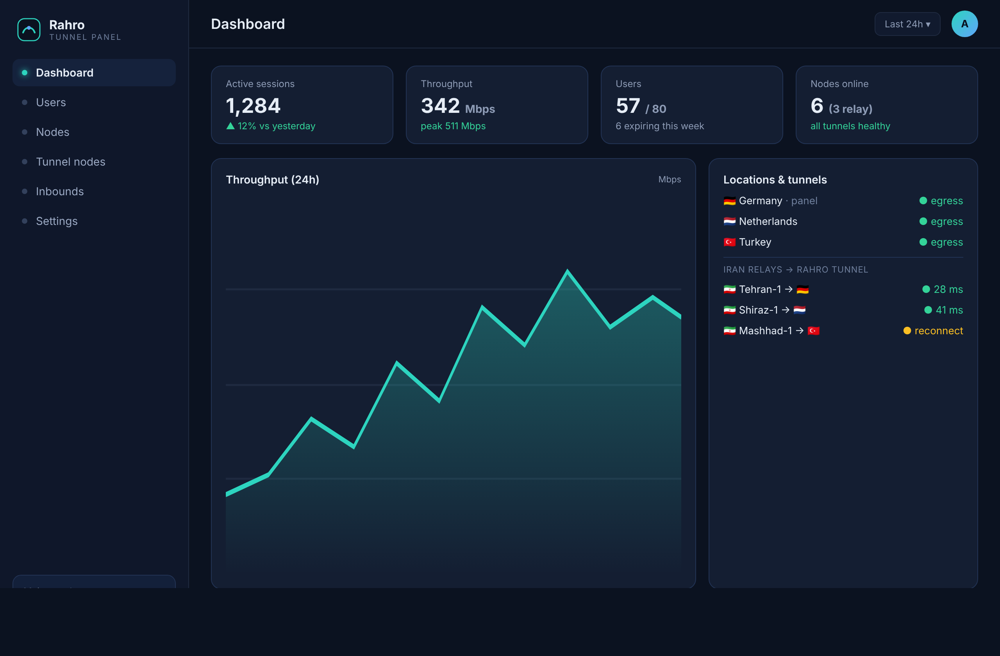

# Rahro — Xray panel + DPI-resistant tunnel

<p align="center"><b>English</b> · <a href="README.fa.md">فارسی 🇮🇷</a></p>



**Rahro** (رهرو, "wayfarer") is a self-hosted management panel for bypassing
internet censorship. It gives you **the full feature set of an Xray panel**
(inbounds for VLESS / VMess / Trojan / Shadowsocks, REALITY, users, quotas,
subscriptions, a Telegram bot API) **plus a dedicated DPI-resistant tunnel** for
relaying an in-country server to a foreign one over traffic that looks like
ordinary HTTPS. One panel, on **Linux or Windows**, manages everything.

> **Honest scope.** No tool is unbreakable; this raises the cost of detection so
> blocking it means blocking normal HTTPS. It cannot defeat a full internet
> shutdown. It uses only vetted cryptography and runs **Xray-core as a managed
> binary** (no Xray/3x-ui source copied). See [docs/SECURITY.md](docs/SECURITY.md).

---

## Install (foreign server)

As root on Ubuntu/Debian/CentOS — download then run (works on any terminal):

```bash
curl -fsSL https://raw.githubusercontent.com/AwmiresGg/rahro-tunnel/HEAD/scripts/install.sh -o rahro-install.sh
sudo bash rahro-install.sh
```

> Or pipe it: `curl -fsSL …/install.sh | sudo bash`. Avoid `bash <(curl …)` —
> some mobile/SSH terminals fail it with `/dev/fd/63: No such file or directory`.

It downloads a prebuilt binary from GitHub (no Go/compile needed), writes
`/etc/rahro/panel.json`, creates an admin, starts the `rahro-panel` service, and
prints your **panel URL** and **admin password**. On first run the panel also
downloads **Xray-core** in the background (a few seconds).

Open the panel at `https://<server-ip>:2053` (self-signed cert — accept the
browser warning). Then log in.

---

## Your first working config (30 seconds)

1. **Inbounds** tab → Protocol **VLESS**, Port **443**, network **tcp**,
   security **reality**.
2. Click **🔑 Generate REALITY keys** (fills the keys into Settings) → **Add inbound**.
3. **Users** tab → **Add user** → click **sub** to copy the subscription link.
4. Paste the link into v2rayNG / NekoBox / sing-box / Clash-Meta → **it connects**.

The panel runs Xray with your inbounds and every active user as a client; the
subscription returns real `vless://…reality` (and vmess/trojan/ss) links that
stock clients understand. Any user/inbound change reloads Xray automatically.

---

## Terminal menu (`rahro`)

Type `rahro` on the server for an `x-ui`-style menu:

```
 1) Status & info      2/3/4) restart / start / stop
 5) Change admin username & password
 6) Change panel port
 7) SSL / access mode  (self-signed | http | domain + Let's Encrypt)
 8) Secret path        9) Public URL
10) View logs         11) Update panel (re-download latest)
12) Show login info   13) Uninstall
```

So SSL, port, and admin credentials can be changed from the terminal **or** the
web **Settings** tab.

### Getting a real certificate (domain)

Point a DNS A record at the server, open ports 80 and 443, then `rahro` → option
**7** → **domain** → enter it. Let's Encrypt is fetched automatically.

---

## Nodes & the Iran tunnel (multi-location + relay)

Rahro also runs a fleet:

- **Location nodes** — extra foreign servers that add locations to every
  subscription.
- **Tunnel nodes** — an **in-country (e.g. Iran) relay**: users connect to a
  domestic IP (low latency, not blocked) and the node relays everything to a
  foreign node over the **Rahro tunnel**, which looks like ordinary HTTPS. Only
  the obfuscated flow crosses the border.

In the panel → **Nodes** / **Tunnel nodes** → add one → copy its **connection
code** → on that server run:

```bash
I="https://raw.githubusercontent.com/AwmiresGg/rahro-tunnel/HEAD/scripts/install.sh"
# foreign egress location:
curl -fsSL "$I" | sudo bash -s -- node   <CONNECTION-CODE> -panel https://<panel-ip>:2053 -insecure
# Iran relay:
curl -fsSL "$I" | sudo bash -s -- tunnel <CONNECTION-CODE> -panel https://<panel-ip>:2053 -insecure
```

Replace `<CONNECTION-CODE>` (no angle brackets) and the panel IP. `-insecure`
skips verifying the panel's self-signed cert; drop it once the panel has a
domain cert.

---

## Telegram sales bot (API token)

Panel → **API tokens** → create one (shown once). Your bot calls the panel with
`Authorization: Bearer <token>`:

```bash
# create a user for a sale (50 GB, 30 days) — returns the subscription link:
curl -s https://<panel>/botapi/users -H "Authorization: Bearer rahro_xxx" \
  -d '{"username":"buyer1","quota_gb":50,"days":30}'
# look up usage:         GET  /botapi/users/<uuid>
# renew / top up:        POST /botapi/users/<uuid>/renew  {"add_days":30,"add_gb":50,"reset_usage":true}
# list locations:        GET  /botapi/nodes
# download a backup:     GET  /botapi/backup        (a .db snapshot, e.g. to archive in Telegram)
```

Create/renew responses include `sub_link`, so the bot sends it straight to the
buyer. Usage returned by `GET /botapi/users/<uuid>` is **real metered traffic**:
the panel reads per-user counters from Xray every ~45s and automatically
disables a user the moment they hit their quota or expiry.

---

## Configuration (`/etc/rahro/panel.json`)

```jsonc
{
  "log_level": "info",
  "panel": {
    "enabled": true,
    "listen": "0.0.0.0:2053",
    "tls_mode": "self-signed",          // off | self-signed | domain
    "domain": "panel.example.com",      // required when tls_mode = domain
    "db_path": "/etc/rahro/rahro-panel.db",
    "public_url": "https://1.2.3.4:2053",// used to build subscription links
    "base_path": "/x7f3a9"              // optional secret URL prefix
  }
}
```

Edit it (or use the `rahro` menu), then `systemctl restart rahro-panel`.

---

## Build from source

```bash
git clone https://github.com/AwmiresGg/rahro-tunnel.git && cd rahro-tunnel
make build        # all binaries
make test         # full test suite
make race         # tests under the race detector
make dist         # cross-compiled Linux (amd64/arm64) + Windows binaries
```

Requires Go 1.26+. Pure Go (CGO disabled); cross-compiles to Linux and Windows.
**Windows Server:** `scripts/install.ps1` (run in an elevated PowerShell).

---

## Status

Working and tested: Xray-core integration (managed binary, auto-download,
config from inbounds+users, reload on change), inbounds (VLESS/VMess/Trojan/
Shadowsocks over tcp/ws/grpc/http/quic with none/tls/reality), REALITY key
generation, working client share links & subscriptions, **real per-user traffic
metering via Xray's stats API with automatic quota/expiry enforcement**,
multi-location nodes, the Iran tunnel-relay data path, admin account change,
**admin login brute-force lockout** and security headers (HSTS under TLS),
**one-click database backup** (panel Settings tab or `GET /botapi/backup`), the
`rahro` terminal menu, the Telegram bot API, and the DPI-resistant Rahro
transport (TLS with a browser uTLS fingerprint, REALITY-style probe → decoy
fallback, frame padding, WebSocket transport). Verified end-to-end against the
real Xray-core binary. All packages pass `go test`; concurrency-sensitive ones
pass `-race`.

Roadmap: full REALITY ClientHello embedding for the Rahro transport; gRPC/QUIC
Rahro transports; two-factor admin login (TOTP; the schema is ready); mobile/GUI
client. See [docs/DESIGN.md](docs/DESIGN.md) and [docs/SECURITY.md](docs/SECURITY.md).

---

## License

Rahro is **proprietary** software — Copyright © 2026 AwmiresGg, all rights
reserved. You may run it to operate your own (including paid) service;
redistributing the Software itself is not permitted. See [LICENSE](LICENSE) and
[THIRD-PARTY-NOTICES.md](THIRD-PARTY-NOTICES.md).
